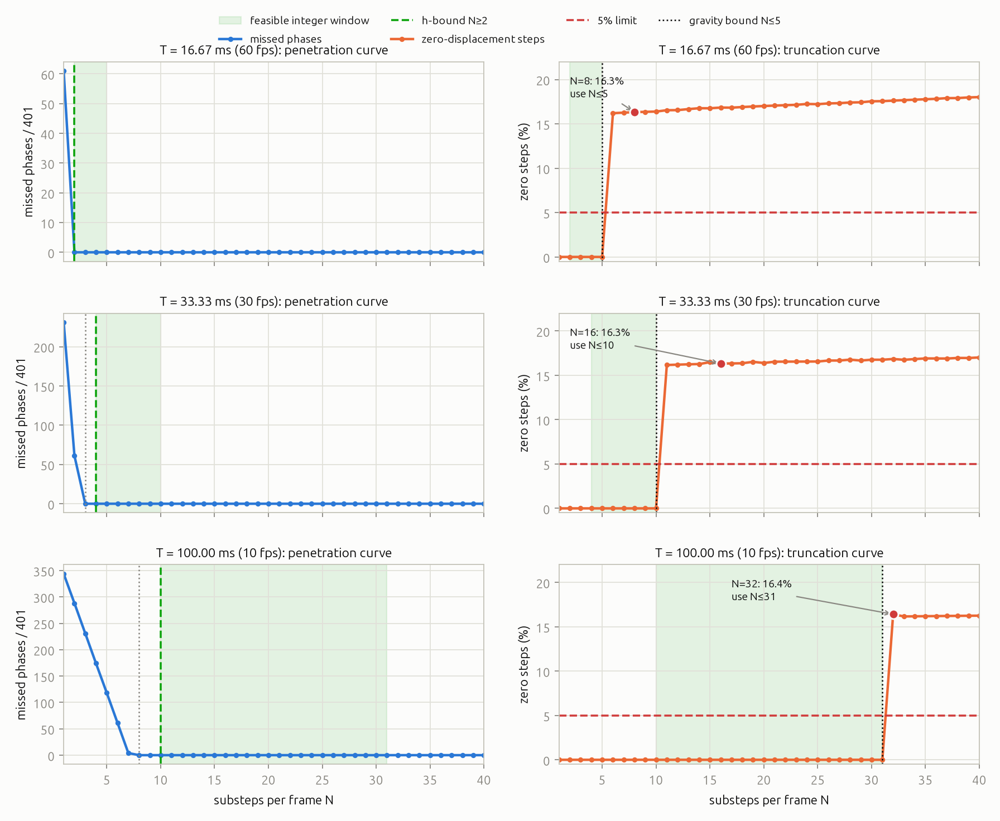

# integrate

`make test` 跑自检；`make plot` 生成“穿透次数—位移截断次数”曲线
（`artifacts/substep_curves.png` 与原始数据 `artifacts/substep_sweep.csv`）。

## 1. 子步上下界

设一帧时长为 \(T\)，拆成 \(N\) 个等长子步：

\[
\tau=\frac{T}{N}
\]

记 \(V\) 为这一帧内的最大下落速率，\(h\) 为地板厚度，\(\varepsilon\) 为位移
截断/量化下限：`|Δy| < ε` 时位移被写成零。

### 防穿透：给出 \(N\) 的下界

题设要求单步位移小于地板厚度：

\[
s_{\max}\simeq V\tau=\frac{VT}{N}<h
\]

所以

\[
N>\frac{VT}{h},\qquad
\boxed{N_{\min}=\left\lfloor\frac{VT}{h}\right\rfloor+1}
\]

严格不等号在整除时也要多取一个子步。对应的步长上界是

\[
\tau<\frac{h}{V}.
\]

对标准球–薄板重叠检测，更精确的检测带宽度其实是 \(h+2r\)（见第 3 节），
因此 \(s<h\) 是更保守、且与半径无关的取法。

### 防饱和：给出 \(N\) 的上界

若只使用代表性位移 \(VT/N\)，要求它大于截断下限：

\[
\frac{VT}{N}>\varepsilon
\]

得到宽松上界

\[
N<\frac{VT}{\varepsilon},\qquad
\boxed{N_{\max,V}=\left\lceil\frac{VT}{\varepsilon}\right\rceil-1}.
\]

但从静止或贴地状态开始时，半隐式欧拉的第一个子步更短：

\[
v_1=g\tau,\qquad \Delta y_1=v_1\tau=g\tau^2.
\]

要求这个最小步不被截成零：

\[
g\tau^2>\varepsilon
\quad\Longleftrightarrow\quad
\tau>\sqrt{\frac{\varepsilon}{g}}.
\]

代入 \(\tau=T/N\)：

\[
N<T\sqrt{\frac{g}{\varepsilon}},\qquad
\boxed{N_{\max,g}=
\left\lceil T\sqrt{\frac{g}{\varepsilon}}\right\rceil-1}.
\]

这比 \(N_{\max,V}\) 紧得多，也解释了曲线中的零位移突增：一旦
\(\tau\le\sqrt{\varepsilon/g}\)，贴地后的每个重力微步都会被截断，随后速度
在碰撞修正中清零，下一步又重复一次。

### 可用整数区间

综合两个条件：

\[
\boxed{
\left\lfloor\frac{VT}{h}\right\rfloor+1
\le N\le
\min\!\left(
\left\lceil\frac{VT}{\varepsilon}\right\rceil-1,\,
\left\lceil T\sqrt{\frac{g}{\varepsilon}}\right\rceil-1,\,
N_{5\%}
\right)}
\]

其中 \(N_{5\%}\) 是实测“零位移步数占比 ≤ 5%”允许的最大 \(N\)。连续形式的
步长窗口为

\[
\boxed{\sqrt{\frac{\varepsilon}{g}}<\tau<\frac{h}{V}}
\]

（若只按匀速代表步长，则下界是 \(\varepsilon/V\)。）

### 什么时候区间为空

- 最直接的参数条件：

  \[
  \boxed{h\le\varepsilon}
  \]

  这时不可能同时满足“单步位移 \(<h\)”和“单步位移 \(>\varepsilon\)”。

- 对静止/贴地重力步，空集条件是：

  \[
  \sqrt{\frac{\varepsilon}{g}}\ge\frac{h}{V}
  \quad\Longleftrightarrow\quad
  \boxed{\varepsilon\ge\frac{gh^2}{V^2}}.
  \]

  球从 \(H\) 高处静止落下时 \(V^2=2gH\)，所以也可写成

  \[
  \boxed{\varepsilon\ge\frac{h^2}{2H}}.
  \]

- 即使 \(h>\varepsilon\)，连续区间存在，也可能因为区间太窄、两端取整后没有
  整数 \(N\)。代码用 `substep_window()` 返回 `1` 表示这种整数空集。
- 若 \(N_{\min}>N_{5\%}\)，则验收条件下仍无可用子步数。此时不能靠继续加
  \(N\) 解决，只能提高位移精度（减小 \(\varepsilon\)）、增大有效检测厚度、
  降低终端速度，或改用连续扫描/射线检测。

## 2. 三档帧时长实测

题目没有给数值参数，下面使用一组可复现的标定：

\[
g=9.81,\quad H=5.0\ \mathrm m,\quad
V=\sqrt{2gH}=9.9045\ \mathrm{m/s},
\]

\[
h=0.10\ \mathrm m,\quad r=0.02\ \mathrm m,\quad
\varepsilon=10^{-4}\ \mathrm m,\quad
\text{运行 }1.20\ \mathrm s.
\]

这组参数的严格步长窗口是

\[
3.193\ \mathrm{ms}<\tau<10.096\ \mathrm{ms}.
\]

取满足 \(s<h\) 的最小整数 \(N\)，调用次数最少：

| 帧时长 | 帧率 | 采用 \(N\) | 整数区间 \([N_{\min},N_{\max,g}]\) | 子步时长 | 401 相位漏检 | 穿透次数 | 零位移步 | 零位移占比 | 调用频率 |
|---:|---:|---:|---:|---:|---:|---:|---:|---:|---:|
| 16.67 ms | 60 fps | 2 | \([2,5]\) | 8.333 ms | 0 | 0 | \(0/144\) | 0.00% | 120/s |
| 33.33 ms | 30 fps | 4 | \([4,10]\) | 8.333 ms | 0 | 0 | \(0/144\) | 0.00% | 120/s |
| 100.00 ms | 10 fps | 10 | \([10,31]\) | 10.000 ms | 0 | 0 | \(0/120\) | 0.00% | 100/s |

单次掉落的相位可能碰巧安全，因此曲线中的“穿透次数”另外扫描了 401 个入射
相位；表中采用的 \(N\) 在所有相位下均无漏检。



### 超过 5% 时给出的修正子步数

故意把三档都过度拆分，截断曲线会越过 5% 红线；此时应向下减少 \(N\)，而不是
继续加子步：

| 帧时长 | 过拆 \(N\) | 零位移占比 | 结论 |
|---:|---:|---:|---|
| 16.67 ms | 8 | 16.32% | 超过 5%，改为 \(\boxed{N\le5}\)；最低调用可取 \(N=2\) |
| 33.33 ms | 16 | 16.32% | 超过 5%，改为 \(\boxed{N\le10}\)；最低调用可取 \(N=4\) |
| 100.00 ms | 32 | 16.41% | 超过 5%，改为 \(\boxed{N\le31}\)；最低调用可取 \(N=10\) |

曲线的取舍因此很明确：小于 \(N_{\min}\) 时穿透曲线不为零；大于
\(N_{\max,g}\) 后零位移比例跳到约 16%（运行末尾贴地阶段约占总时长 16%）。
应在中间绿色平台内选 \(N\)，追求最少调用就取 \(N_{\min}\)，需要安全余量可
在平台内上调。

作为空集回归，把 \(\varepsilon\) 改成 \(1\ \mathrm{mm}\) 时，
\(\varepsilon=gh^2/V^2\) 恰好到达临界值；三档的重力上界分别只剩
\(N_{\max,g}=1,3,9\)，而防穿透下界是 \(2,4,10\)，严格区间全部为空。

## 3. \(r>h\) 的几何情形与替代方案

设薄板占据 \(y\in[-h,0]\)。球与板发生重叠时，球心的检测区间不是厚度 \(h\)，
而是向两侧各扩一个半径：

\[
y\in[-h-r,r],\qquad B=h+2r.
\]

一个向下子步从 \(y_0\) 到 \(y_1<y_0\)，两端都在检测带外的充要条件是

\[
y_0>r,\qquad y_1<-h-r,
\]

因此

\[
s=y_0-y_1>h+2r.
\]

对给定步长 \(s\)，漏检成立的半径条件是

\[
\boxed{r<\frac{s-h}{2}}.
\]

如果还要同时满足题目所说的 \(r>h\)，则完整条件为

\[
\boxed{h<r<\frac{s-h}{2}},
\]

它非空还要求

\[
\boxed{s>3h}.
\]

这里需要修正一个过强表述：**对标准球–AABB 端点重叠检测，单纯 \(r>h\) 并不
意味着“无论怎么拆都测不到”。** 相反，\(r\) 越大，检测带 \(h+2r\) 越宽；理想
浮点运算下持续增大 \(N\)、缩小 \(s\)，一定能采到检测带。只有再叠加下面两个
条件之一，“怎么拆都不行”才成立：

1. 使用只检查球心是否进入薄板的朴素检测器，半径根本没有扩展检测带；或
2. 截断/量化使最小有效位移仍能跳过扩展带，例如

   \[
   \boxed{\varepsilon\ge h+2r},
   \]

   导致精确检测带对应的区间 \((h+2r)/V<\tau<\varepsilon/V\) 为空。

### 替代方案

- **延展厚度/查询体**：把不可见碰撞查询厚度从 \(h\) 增加到 \(h_{\rm ext}\)，
  使球感知的扩展带满足

  \[
  h_{\rm ext}+2r>s_{\max},
  \]

  若检测器只看球心，则直接要求 \(h_{\rm ext}>s_{\max}\)。同时仍需
  \(h_{\rm ext}>\varepsilon\)，否则量化区间还是空的。渲染可用薄地板，物理
  查询使用加厚的隐形板。
- **射线/扫描检测（CCD）**：检测本步完整线段与扩展球心带的相交，而不是只测
  两个端点。`swept_interval_hit()` 实现了这一区间求交；自检中
  \(h=0.10,r=0.20\) 的大球一步从 \(y=0.21\) 跳到 \(y=-0.99\)，端点均漏检，
  射线仍返回命中。射线必须使用截断前的原始位移/目标位置；若先把位移截成
  零，再拿零向量做射线，仍然无法恢复运动意图。

## 4. 复现

```sh
make test    # C 自检：边界、三档帧时长、5% 上限、空集和射线检测
make plot    # Python 扫描 + PNG/CSV 曲线
```
