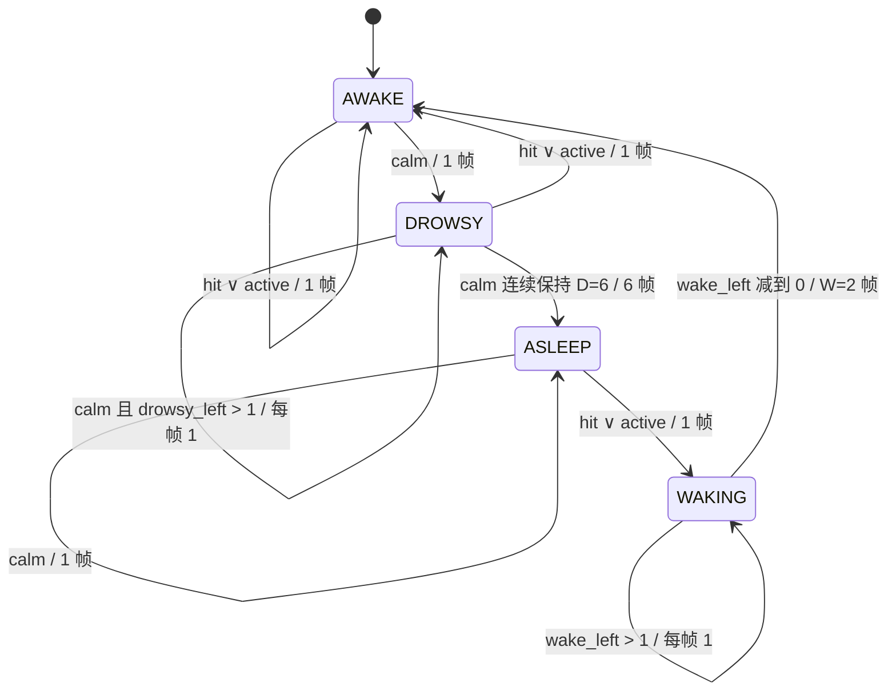

# sleep

球的四态休眠状态机。`make test` 跑完备性、边界、四态进入/离开和唤醒延迟诊断；`make sweep` 重新生成阈值扫描 CSV。

```sh
make -C sleep test
make -C sleep sweep
python3 sleep/tools/plot_tradeoff.py \
  --csv artifacts/sleep_tradeoff.csv \
  --png artifacts/sleep_tradeoff.png
```

## 1. 状态转移图

一帧对应一次 `sleep_step()`；边的帧数表示：从源状态开始提交条件，到调用后能观察到目标状态所需的 `step()` 次数。



ASCII 环：

```text
        calm / 1                 calm held D=6 / D 帧
 AWAKE ───────────► DROWSY ─────────────────────────► ASLEEP
   ▲                   │                                │
   │                   │ hit ∨ active / 1               │ hit / 1
   │                   ▼                                ▼
   └─────────────── AWAKE ◄────────────────────────── WAKING
                     WAKING → AWAKE：W=2 帧
```

主环各边帧预算为：

```text
AWAKE → DROWSY → ASLEEP → WAKING → AWAKE
   1       D         1        W
```

| 边 | 触发条件 | 帧预算 |
|---|---|---:|
| `AWAKE → AWAKE` | `hit ∨ active` | 1 |
| `AWAKE → DROWSY` | 首个 `calm` | 1 |
| `DROWSY → DROWSY` | `calm`，`drowsy_left > 1` | 每帧 1 |
| `DROWSY → AWAKE` | `hit ∨ active` | 1 |
| `DROWSY → ASLEEP` | `calm` 连续保持 `D` 帧 | `D` |
| `ASLEEP → ASLEEP` | `calm` | 1 |
| `ASLEEP → WAKING` | `hit ∨ active`（碰撞优先；超过睡眠速度阈值的 active 也安全唤醒） | 1 |
| `WAKING → WAKING` | `wake_left > 1` | 每帧 1 |
| `WAKING → AWAKE` | 唤醒 ramp 计数结束 | `W` |

原始输入只有两个 bit：`hit`、`active`。归一化优先级是 `hit > active > calm`，所以 `{hit=1, active=1}` 也有确定归属。

## 2. 完备性证明：不存在第五种状态

状态集合是有限集：

```text
S = {AWAKE, DROWSY, ASLEEP, WAKING}
```

归一化后的输入字母表也是有限且穷尽的：

```text
I = {CALM, ACTIVE, HIT}
```

转移表如下，计数条件只决定同一条保持边是否走完，不引入新的状态：

| 当前状态 | `CALM` | `ACTIVE` | `HIT` |
|---|---|---|---|
| `AWAKE` | `DROWSY` | `AWAKE` | `AWAKE` |
| `DROWSY` | `DROWSY` 或 `ASLEEP` | `AWAKE` | `AWAKE` |
| `ASLEEP` | `ASLEEP` | `WAKING` | `WAKING` |
| `WAKING` | `WAKING` 或 `AWAKE` | `WAKING`/`AWAKE` | `WAKING`/`AWAKE` |

证明用归纳法：

1. `sleep_init()` 一定把状态初始化成 `AWAKE ∈ S`。
2. 假设第 `k` 帧状态属于 `S`。对三种归一化输入，`sleep_step()` 的 `switch` 每个分支都只把状态赋成 `S` 中的四个枚举之一。
3. 因此第 `k+1` 帧状态仍属于 `S`。由归纳法，任意有限或无限输入序列都不会到达第五种命名状态。

两个计数器同样有界：`drowsy_left` 只在 `D..0` 间递减或被清零/重置；`wake_left` 只在 `W..0` 间递减。`WAKING` 没有返回 `DROWSY/ASLEEP` 的边，所以唤醒路径不会被后续 `calm` 重启。

C 自检还穷举了 4 个起始状态 × 全部 `4^8` 个两-bit 输入序列（共 262,144 条序列），每一步都断言状态仍在四态内。唤醒路径另外穷举了 `W=4` 时撞击后的全部 `4^4` 个输入尾巴，帧数都恰好是 `1+W=5`，说明后续 calm/active/hit 不会重启或延长 ramp。若内存中的枚举被破坏成 `99` 或负值，`switch` 前的枚举范围守卫会在下一帧恢复为 `AWAKE`，并记录 `INVALID->AWAKE`；该守卫先于配置校验执行，所以配置同时损坏也不会让第五种编码状态继续停留。

注意：任意输入可以让 `AWAKE ↔ DROWSY` 反复循环，因此“多久睡着”只有在 `D+1` 个连续静息帧条件下才有上界；但这破坏不了状态集合的封闭性。唤醒延迟上界是从已经处于 `ASLEEP` 且第 0 帧提交撞击开始计算的。

## 3. 最长唤醒延迟：从环上反解

从 `ASLEEP` 被撞，到物理/控制可以按完全醒着的球处理，路径固定为两条边：

```text
ASLEEP ──hit / 1 帧──► WAKING ──wake_left 到 0 / W 帧──► AWAKE
```

所以：

```text
L_wake_max = cost(ASLEEP → WAKING) + cost(WAKING → AWAKE)
           = 1 + W
```

如果“被撞醒”只指进入 `WAKING`，那么撞击采样延迟是 1 帧；`1+W` 是到完全 `AWAKE` 的最长延迟。

当前标定 `W=2`：

```text
L_wake_max = 1 + 2 = 3 帧 = 50 ms @ 60 Hz
```

实测对 `W=1..16` 全部等于 `1+W`，没有超过图上界。`D` 不在唤醒路径上；把 `D` 加进唤醒延迟是错误的。所谓“待睡帧越长，唤醒越迟钝”只在强迫 `D=W=N`、共用一个计数器时成立。

## 4. 用两条曲线定帧数

扫描数据在 `artifacts/sleep_tradeoff.csv`，图在 `artifacts/sleep_tradeoff.png`：


回放包含 63 个短静息缺口；若状态机在长度小于 10 帧的缺口里进入 `ASLEEP`，随后又被撞击结束，记为一次误睡。关键数据：

| 候选 `N` | 误睡次数（`D=N`） | 唤醒上界（`W=N`） |
|---:|---:|---:|
| 1 | 55 | 2 |
| 2 | 45 | 3 |
| 6 | 9 | 7 |
| 8 | 2 | 9 |
| 9 | 0 | 10 |

标定预算：

- 误睡预算：`≤ 10` 次。取满足预算的最小 `D`，避免无谓推迟真正睡眠：`D=6`，实测 9 次。
- 唤醒预算：`≤ 3` 帧。`1+W ≤ 3`，所以最大允许值是 `W=2`；取边界值以保留两帧 ramp：`W=2`。

如果退回单计数器并令 `D=W=N`，两条曲线给出冲突区间：

```text
误睡 ≤ 10  ⇒ N ≥ 6
唤醒 ≤ 3   ⇒ N ≤ 2
```

没有公共解。这正是一个布尔量或一个共享计数器会丢失“半睡/半醒”语义的代价。四状态使用两个独立计数器后得到 `D=6, W=2`：误睡达标，同时唤醒上界保持 3 帧。

该数值来自仓库内的确定性合成回放；接入真实游戏时，应把 `GAP_FREQUENCY` 换成线上静息缺口分布，再重跑扫描。

## 5. 接入碰撞/积分循环

碰撞模块给出 `Contact.hit`，速度/能量阈值给出 `active`；不要把旧的 `is_sleeping` bool 再当作状态存储：

```c
SleepInput input = {
    .hit = contact.hit && impact_speed2 > HIT_EPS2,
    .active = speed2 > SLEEP_SPEED2
};
sleep_step(&ball.sleep, input);

/* 只有 ASLEEP 跳过积分；WAKING 仍参与碰撞求解，避免撞醒当帧漏冲量。 */
if (ball.sleep.state == SLEEP_ASLEEP)
    continue;
```

旧 bool 最多只能表达 `ASLEEP` 与非 `ASLEEP`，会把 `DROWSY` 和 `WAKING` 压成同一个值；四态枚举和两个独立计数器保留了“即将睡”和“正在醒”的区别。

## 6. 四态进入/离开与越界诊断

自检中的对应用例：

| 状态 | 进入用例 | 离开用例 |
|---|---|---|
| `AWAKE` | `enter_awake_from_waking`：`WAKING → AWAKE` | `leave_awake_to_drowsy`：首个 calm |
| `DROWSY` | `enter_drowsy_from_awake` | `leave_drowsy_to_awake`（打扰）和 `leave_drowsy_to_asleep`（超时） |
| `ASLEEP` | `enter_asleep_from_drowsy` | `leave_asleep_to_waking` |
| `WAKING` | `enter_waking_from_asleep` | `leave_waking_to_awake` |

生产 FSM 的唤醒路径不会越界。为了证明越界报告可用，自检注入了两类集成故障：

```text
wake_bound_violation actual_frames=6 bound_frames=3 stuck_edge=ASLEEP->WAKING
wake_bound_violation actual_frames=8 bound_frames=3 stuck_edge=WAKING->AWAKE
```

接入主循环时，在提交撞击帧前调用 `sleep_wake_watch_begin()`，每帧 `sleep_step()` 后调用 `sleep_wake_watch_observe()`。监测器在第一次观察到 `AWAKE` 时冻结 `actual_frames`，之后继续喂帧会被忽略，因此主循环无需恰好在唤醒当帧停止监测。最终读 `SleepWakeReport`：

- `actual_frames > bound_frames` 时测试失败；
- `stuck_edge == SLEEP_EDGE_ASLEEP_TO_WAKING`：撞击没有在第 1 帧送进 FSM，或该边被卡住；
- `stuck_edge == SLEEP_EDGE_WAKING_TO_AWAKE`：已进入唤醒 ramp，但计数/边完成时间超过 `W`。

报告同时保留实际延迟和第一条失配边，避免只看到“唤醒慢”却不知道卡在哪条转移上。
